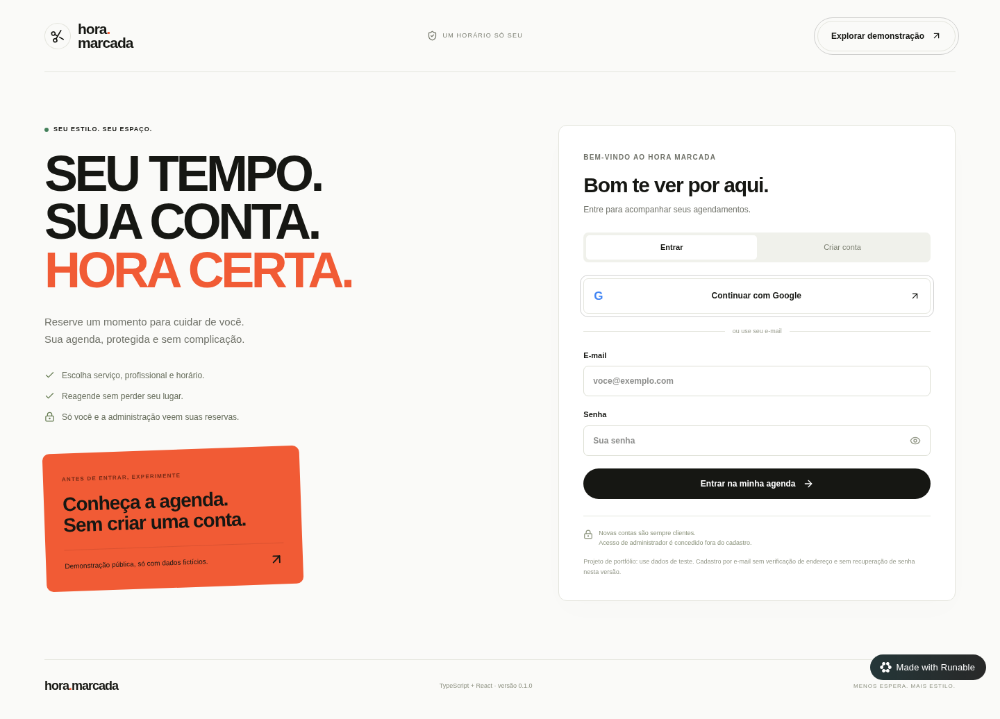
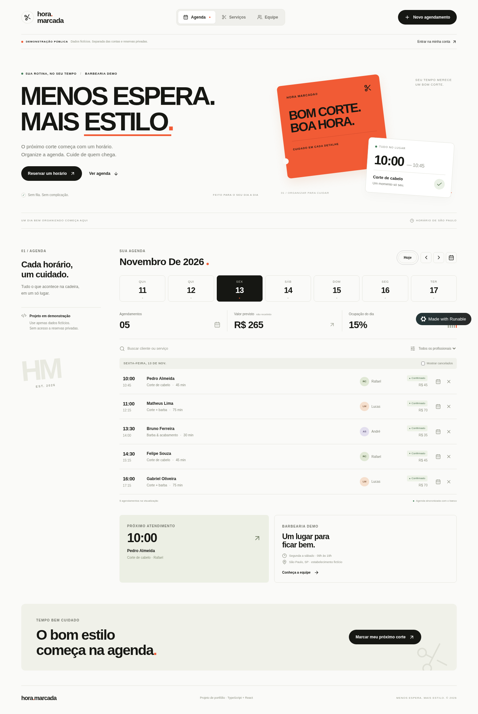
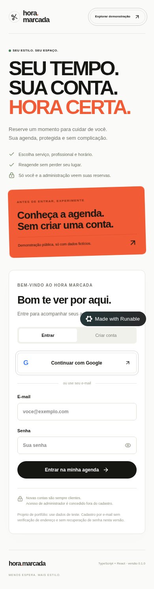
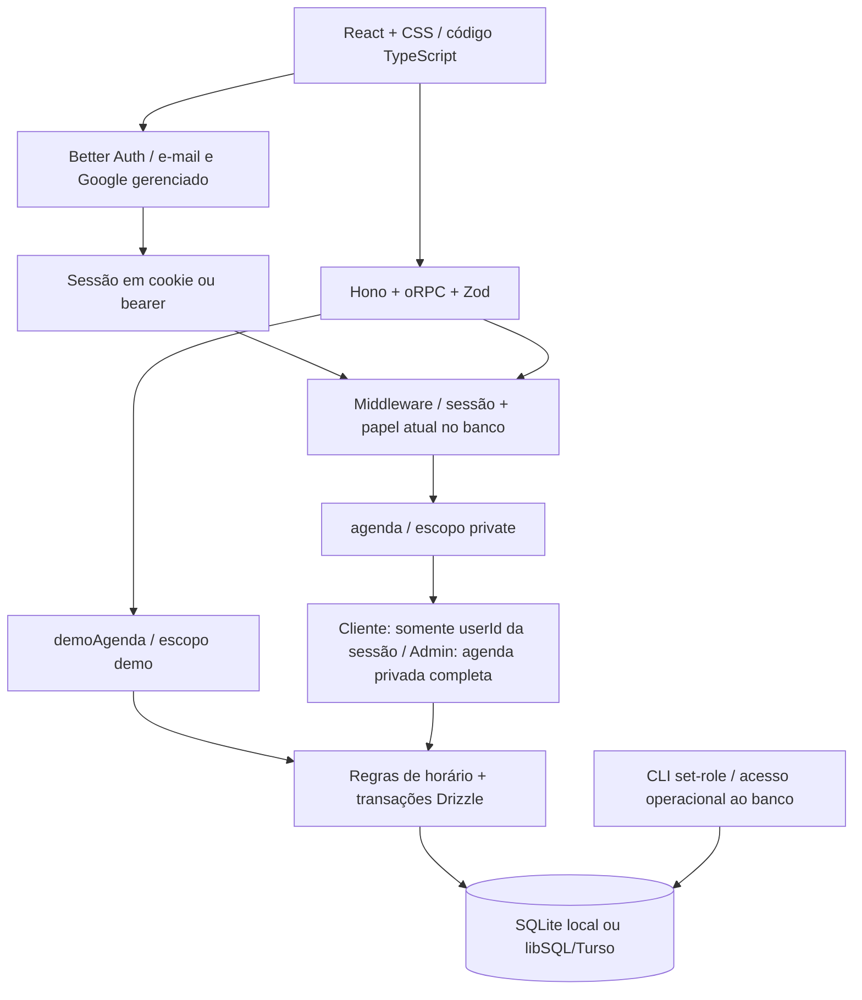

# Hora Marcada

Repositório: [GuiNascimento77/hora-marcada](https://github.com/GuiNascimento77/hora-marcada) · Autoria: Guilherme Nascimento · Licença MIT

**Menos espera. Mais estilo.** Agenda de barbearia em português, construída para demonstrar uma aplicação com interface, API, persistência e regras de negócio testadas.

> **Versão 0.1 — portfólio com autenticação e permissões.** Clientes acessam somente suas reservas; administradores gerenciam a agenda privada. A rota `/demo` continua pública, em um escopo separado. Use dados fictícios: este projeto ainda não está pronto para operar um negócio com dados pessoais.

## Telas






## O que funciona

- Agenda por data, navegação entre dias e calendário nativo.
- Busca por cliente ou serviço, filtro por profissional e histórico de cancelamentos.
- Catálogo de quatro serviços e equipe de três profissionais fictícios.
- Agendamento em duas etapas, com consulta de horários disponíveis.
- Cancelamento que libera o horário sem apagar o histórico.
- Reagendamento atômico: se o novo horário está ocupado, a reserva antiga permanece intacta.
- Resumo de quantidade, valor previsto e ocupação do dia.
- Banco persistente: os dados permanecem após recarregar a página.
- Layout responsivo e modal navegável por teclado.
- Cadastro e login por e-mail/senha com Better Auth; senha armazenada como hash.
- Google gerenciado configurado na prévia; **fluxo completo com conta Google ainda não validado manualmente**.
- Autorização no servidor, dono da reserva definido pela sessão e papéis consultados no banco a cada requisição.
- Administrador concedido somente pela ferramenta de terminal, nunca pelo formulário.
- Demo isolada de reservas privadas; telefone recusado pela API pública.
- Limite de tentativas de login/cadastro e revogação de sessão ao sair.

O **valor previsto não é receita recebida**. A ocupação considera os minutos reservados, divididos por 10 horas de expediente × 3 profissionais; não é um relatório financeiro nem um controle de presença.

## Linguagem e ferramentas

| Parte | Tecnologia | Para que serve |
|---|---|---|
| Linguagem principal | **TypeScript** | Tipagem da interface, API, regras e testes |
| Interface | React | Componentes e atualização das telas |
| Aparência | CSS, Tailwind | Layout, cores, tipografia e responsividade |
| Execução | Bun | Instalação, scripts, servidor e testes |
| Servidor e API | Hono + oRPC + Zod | Receber requisições tipadas e validar entradas |
| Banco | SQLite/libSQL + Drizzle | Guardar dados e executar transações |
| Consulta e cache | TanStack Query | Carregamento, erros e atualização após salvar |
| Build | Vite + TypeScript | Verificação e empacotamento |

**React não é uma linguagem.** É uma biblioteca. **Bun não é uma linguagem.** É uma ferramenta de execução. O código principal é TypeScript; CSS e HTML participam da apresentação; a migração do banco usa SQL.

## Rodar localmente — sem conta externa

Requisitos: Bun (verificado com 1.4.4), Git e navegador. Execute na raiz do projeto:

```bash
bun install --frozen-lockfile
cp .env.template .env
# Gere e grave um segredo aleatório; não compartilhe o .env.
bun -e 'const p=".env"; await Bun.write(p,(await Bun.file(p).text()).replace(/^BETTER_AUTH_SECRET=.*$/m,"BETTER_AUTH_SECRET="+crypto.randomUUID()+crypto.randomUUID()))'
bun run db:push
bun run dev
```

Abra **http://localhost:4200** para entrar/cadastrar, **/agenda** para a área privada ou **/demo** para experimentar sem conta. No Windows, copie `.env.template` para `.env` pelo Explorer ou use `Copy-Item .env.template .env` no PowerShell. Para gerar o segredo no PowerShell: `bun -e "console.log(crypto.randomUUID()+crypto.randomUUID())"` e cole o resultado em `BETTER_AUTH_SECRET` no arquivo `.env`.

A configuração de exemplo usa SQLite local em `hora-marcada.db`, sem chave paga ou conta de anúncios. O catálogo e as reservas fictícias são criados na primeira consulta; um marcador persistido impede duplicação. As reservas de exemplo ficam nos primeiros dias da execução, não são recriadas todos os dias.

Na prévia gerenciada, a mesma aplicação usa o banco libSQL/Turso provisionado pela plataforma. O arquivo `.env` real não acompanha o código para download e não deve ser enviado ao GitHub.

Google depende de `APPLICATION_ID`, `VITE_APPLICATION_ID` e `VITE_RUNABLE_AUTH_ISSUER` da configuração gerenciada. Sem esses valores, o projeto local funciona por e-mail/senha e informa isso na tela. Não reutilize identificadores de outro app. Não são necessárias chaves Google para usar a integração gerenciada.

### Conceder ou revogar administração

Cadastre a conta normalmente. Depois, na pasta **packages/web**, execute:

```bash
# Apenas consultar o papel:
bun --env-file=../../.env tools/set-role.ts gestor@example.test
# Conceder administração a uma conta existente:
bun --env-file=../../.env tools/set-role.ts gestor@example.test admin
# Revogar administração:
bun --env-file=../../.env tools/set-role.ts gestor@example.test customer
```

A ferramenta exige acesso ao banco configurado no `.env`; não existe endpoint público de promoção. Confira o banco de destino antes de executar. Recarregue a tela para atualizar o rótulo do papel; a API revalida a permissão em cada requisição. Novos cadastros são sempre clientes, mesmo se o corpo enviar `role: "admin"`.

## Regras de agendamento

- Fuso do estabelecimento: `America/Sao_Paulo`.
- Segunda a sábado, 09h às 19h; domingo fechado.
- Horários em intervalos de 15 minutos, até 60 dias de antecedência.
- O atendimento deve terminar antes ou exatamente às 19h.
- Reservas futuras: a API rejeita horários que já passaram.
- Uma reserva ocupa todos os blocos de 15 minutos da duração do serviço.
- Um índice único em `(escopo, profissional, data, minuto)` impede sobreposição no banco, inclusive em requisições concorrentes. Demo e privado têm disponibilidade independente.
- Transações gravam a reserva e seus blocos juntos. Conflitos desfazem toda a alteração.
- Preços são inteiros em centavos, não números decimais.

Em SQLite local, a conexão serializa transações para evitar interferência entre commit e rollback. O índice único continua garantindo exclusividade. Outros processos ainda podem causar bloqueio temporário; a API de criação/reagendamento traduz esse bloqueio para um conflito recuperável.

## Arquitetura e autorização



Não basta esconder botões: listagem, cancelamento, reagendamento e `excludeId` verificam permissões na API. Consultas e alterações de reservas de outro cliente retornam um erro genérico, sem revelar se o registro existe. O cache da interface usa escopo/usuário/papel e é limpo nas trocas de conta. O catálogo é compartilhado; as reservas não.

## Estrutura para estudar

```text
packages/web/src/
  api/
    domain/scheduling.ts                 regras puras de horário
    domain/scheduling.test.ts            testes das regras
    database/schema.ts                   tabelas e restrições
    database/auth-schema.ts              tabelas de contas e sessões
    database/connection.ts               fila de transações no SQLite local
    database/seed.ts                     dados fictícios iniciais
    routes/agenda.ts                     procedimentos da API
    auth.ts                             configuração do Better Auth
    middleware/auth.ts                   autenticação, papel e propriedade
    routes/profile.ts                    perfil protegido
    routes/agenda.integration.test.ts    testes com SQLite temporário
    index.ts                             composição da API
  web/
    pages/agenda-page.tsx                tela principal e vistas
    pages/auth-page.tsx                  entrar/cadastrar
    components/auth-gate.tsx             proteção das rotas e logout
    components/booking-modal.tsx         reserva e acessibilidade do modal
    queries/agenda.ts                    consultas e mutações tipadas
    agenda.css                          aparência da aplicação
packages/web/drizzle/                   migração SQL versionada
tests/browser-smoke.py                  teste opcional de navegador
tests/auth-browser-smoke.py             contas fictícias e isolamento no navegador
packages/web/tools/set-role.ts          ferramenta operacional de papéis
docs/ETAPAS.md                          explicações para iniciantes
.github/workflows/ci.yml                verificação no GitHub Actions
```

O monorepo também contém os pacotes-base de Expo e Electron. **Esta entrega implementa apenas web responsiva**, não um aplicativo móvel nativo ou desktop. Arquivos `__` são infraestrutura protegida do template; concentre o estudo nos arquivos acima.

## Testes e qualidade

```bash
bun run test       # 60 testes: 20 de regras + 16 de reservas + 24 de acesso
bun run build      # TypeScript + build
bun run lint       # convenções e acessibilidade estática
```

Os testes de integração usam um **banco temporário isolado**, não o banco da aplicação. Cobrem duplicatas, sobreposição, rollback, cancelamento, entradas inválidas, concorrência, sessões reais, senha incorreta, hash, expiração, logout, escalação de papel, origem hostil, limite de login, propriedade de reservas, revogação de papel e isolamento da demo.

Teste opcional de navegador, com a aplicação iniciada:

```bash
pip install playwright
python tests/browser-smoke.py
python tests/auth-browser-smoke.py
```

Requer Google Chrome; indique `CHROME_PATH` se o caminho não for `/usr/bin/google-chrome`. `APP_URL` permite informar outra URL. Esse teste cria e cancela uma reserva fictícia na aplicação acessada. Verifica persistência após recarregar, reagendamento, cancelamento, catálogo, equipe, busca, modal e ausência de overflow em 360/390/768/1024/1440px.

O segundo teste cria duas contas fictícias persistentes e uma reserva, depois cancela a reserva e faz logout. Com a URL local padrão e o `.env` disponível, promove uma conta via CLI para verificar a tela administrativa e revoga o papel ao final. Com `APP_URL` explícita, não executa a CLI. Uma falha pode deixar dados de teste no banco. Os testes de navegador **não** fazem login em uma conta Google real.

O workflow executa testes, build e lint em pushes/PRs. Consulte os resultados de cada execução em [GitHub Actions](https://github.com/GuiNascimento77/hora-marcada/actions). Os testes de navegador são opcionais e separados desse workflow; a validação completa com Google é manual.

## Próximas etapas

- [x] Autenticação e separação entre cliente e administrador.
- [x] Impedir acesso às reservas de outras pessoas.
- [x] Demo isolada e capturas no README.
- [ ] Validar login completo com Google manualmente.
- [ ] Verificação de e-mail, recuperação de senha e vinculação de contas planejada.
- [ ] Cadastro/edição de serviços, profissionais e expediente.
- [ ] Limitação de requisições da agenda pública, auditoria e política de dados.
- [ ] Teste automatizado de acessibilidade e navegação mais ampla.
- [x] Repositório público no GitHub.

Sem pagamentos, WhatsApp, lembretes, múltiplos estabelecimentos ou confirmação de presença. E-mail/senha ainda não verifica endereço nem recupera senha: não use senhas reutilizadas nem dados reais. Bearer em localStorage facilita a prévia em iframe, mas requer atenção a XSS; uma implantação real precisa de revisão de segurança, HTTPS, política de retenção/exclusão, monitoramento e backups. O limite de login não é proteção completa contra abuso da demo pública.

## Licença

MIT. Veja `LICENSE`.
